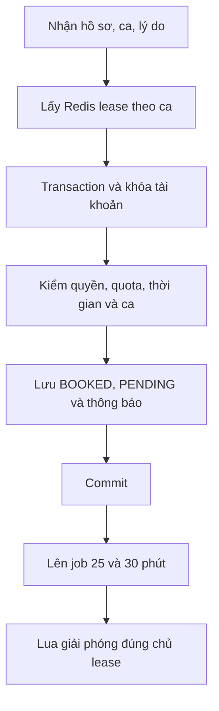

# API bệnh nhân

<a id="createrelative"></a>

## POST `/api/v1/patient/relatives` — Thêm hồ sơ người thân

### 1. Chức năng và vai trò

Thêm hồ sơ người thân. **Vai trò sử dụng:** PATIENT.

### 2. Đầu vào

| Trường | Kiểu | Vị trí | Điều kiện |
|---|---|---|---|
| `accessToken / Authorization` | `JWT` | Cookie / Bearer header | Phiên hợp lệ; đúng vai trò của API. |
| `fullName` | `string` | Body JSON | Bắt buộc; 2–60 ký tự chữ và khoảng trắng. |
| `dateOfBirth` | `DateOnly` | Body JSON | Ngày YYYY-MM-DD; không tương lai, giới hạn tuổi theo service. |
| `gender` | `GenderStatus` | Body JSON | Bắt buộc. |
| `phoneNumber` | `string` | Body JSON | Bắt buộc; điện thoại di động Việt Nam 10 chữ số hợp lệ. |
| `address` | `string?` | Body JSON | Không có [Required]; điều kiện theo nhánh nghiệp vụ. |
| `relationship` | `string` | Body JSON | Quan hệ hợp lệ; SELF của hồ sơ bản thân không được đổi. |

### 3. Luồng xử lý kỹ thuật

Lấy tài khoản hiện tại; kiểm tên, điện thoại, ngày sinh, quan hệ hợp lệ và trùng hồ sơ active; tạo PatientProfile thuộc user.

### 4. Đầu ra

200: chuỗi thông báo từ AddRelative.

### 5. Mã code

`WebDeveloper/Controllers/Api/PatientApiController.cs:26`

```csharp
public async Task<IActionResult> CreateRelative([FromBody] RelativeRequest req)
{
    // Lấy tài khoản hiện tại từ danh tính đã xác thực.
    var user = await SecurityHelper.GetCurrentUser(HttpContext, _db);
    // Gọi service thực hiện nghiệp vụ và kiểm tra điều kiện.
    return Ok(await _patientService.AddRelative(user, req));
}

```

<a id="getrelativedetail"></a>

## GET `/api/v1/patient/relatives/{id}` — Xem một hồ sơ người khám

### 1. Chức năng và vai trò

Xem một hồ sơ người khám. **Vai trò sử dụng:** PATIENT.

### 2. Đầu vào

| Trường | Kiểu | Vị trí | Điều kiện |
|---|---|---|---|
| `accessToken / Authorization` | `JWT` | Cookie / Bearer header | Phiên hợp lệ; đúng vai trò của API. |
| `id` | `int` | Path | Định danh đối tượng trong route. |

### 3. Luồng xử lý kỹ thuật

PatientService tìm theo id, kiểm chủ tài khoản và trạng thái hồ sơ theo luồng đọc.

### 4. Đầu ra

200: RelativeResponse.

### 5. Mã code

`WebDeveloper/Controllers/Api/PatientApiController.cs:33`

```csharp
public async Task<IActionResult> GetRelativeDetail(int id)
{
    // Lấy tài khoản hiện tại từ danh tính đã xác thực.
    var user = await SecurityHelper.GetCurrentUser(HttpContext, _db);
    // Gọi service thực hiện nghiệp vụ và kiểm tra điều kiện.
    return Ok(await _patientService.GetRelativeById(user, id));
}

```

<a id="getallrelatives"></a>

## GET `/api/v1/patient/relatives` — Danh sách hồ sơ người khám

### 1. Chức năng và vai trò

Danh sách hồ sơ người khám. **Vai trò sử dụng:** PATIENT.

### 2. Đầu vào

| Trường | Kiểu | Vị trí | Điều kiện |
|---|---|---|---|
| `accessToken / Authorization` | `JWT` | Cookie / Bearer header | Phiên hợp lệ; đúng vai trò của API. |

### 3. Luồng xử lý kỹ thuật

Query hồ sơ thuộc tài khoản và đang active, gồm hồ sơ bản thân/người thân theo dữ liệu hiện có.

### 4. Đầu ra

200: List<RelativeResponse>.

### 5. Mã code

`WebDeveloper/Controllers/Api/PatientApiController.cs:40`

```csharp
public async Task<IActionResult> GetAllRelatives()
{
    // Lấy tài khoản hiện tại từ danh tính đã xác thực.
    var user = await SecurityHelper.GetCurrentUser(HttpContext, _db);
    // Gọi service thực hiện nghiệp vụ và kiểm tra điều kiện.
    return Ok(await _patientService.GetRelatives(user));
}

```

<a id="updaterelative"></a>

## PUT `/api/v1/patient/relatives/{id}` — Sửa hồ sơ người khám

### 1. Chức năng và vai trò

Sửa hồ sơ người khám. **Vai trò sử dụng:** PATIENT.

### 2. Đầu vào

| Trường | Kiểu | Vị trí | Điều kiện |
|---|---|---|---|
| `accessToken / Authorization` | `JWT` | Cookie / Bearer header | Phiên hợp lệ; đúng vai trò của API. |
| `id` | `int` | Path | Định danh đối tượng trong route. |
| `fullName` | `string` | Body JSON | Bắt buộc; 2–60 ký tự chữ và khoảng trắng. |
| `dateOfBirth` | `DateOnly` | Body JSON | Ngày YYYY-MM-DD; không tương lai, giới hạn tuổi theo service. |
| `gender` | `GenderStatus` | Body JSON | Bắt buộc. |
| `phoneNumber` | `string` | Body JSON | Bắt buộc; điện thoại di động Việt Nam 10 chữ số hợp lệ. |
| `address` | `string?` | Body JSON | Không có [Required]; điều kiện theo nhánh nghiệp vụ. |
| `relationship` | `string` | Body JSON | Quan hệ hợp lệ; SELF của hồ sơ bản thân không được đổi. |

### 3. Luồng xử lý kỹ thuật

Kiểm chủ, chặn hồ sơ inactive; giữ quan hệ SELF, kiểm ngày sinh, điện thoại và trùng hồ sơ; lưu thông tin sửa.

### 4. Đầu ra

200: chuỗi thông báo.

### 5. Mã code

`WebDeveloper/Controllers/Api/PatientApiController.cs:47`

```csharp
public async Task<IActionResult> UpdateRelative(int id, [FromBody] RelativeRequest req)
{
    // Lấy tài khoản hiện tại từ danh tính đã xác thực.
    var user = await SecurityHelper.GetCurrentUser(HttpContext, _db);
    // Gọi service thực hiện nghiệp vụ và kiểm tra điều kiện.
    return Ok(await _patientService.UpdateRelative(user, id, req));
}

```

<a id="deleterelative"></a>

## DELETE `/api/v1/patient/relatives/{id}` — Xóa mềm hồ sơ người thân

### 1. Chức năng và vai trò

Xóa mềm hồ sơ người thân. **Vai trò sử dụng:** PATIENT.

### 2. Đầu vào

| Trường | Kiểu | Vị trí | Điều kiện |
|---|---|---|---|
| `accessToken / Authorization` | `JWT` | Cookie / Bearer header | Phiên hợp lệ; đúng vai trò của API. |
| `id` | `int` | Path | Định danh đối tượng trong route. |

### 3. Luồng xử lý kỹ thuật

Kiểm chủ; chặn SELF và hồ sơ còn lịch PENDING/CONFIRMED; đặt IsActive=false rồi SaveChanges.

### 4. Đầu ra

200: chuỗi thông báo.

### 5. Mã code

`WebDeveloper/Controllers/Api/PatientApiController.cs:54`

```csharp
public async Task<IActionResult> DeleteRelative(int id)
{
    // Lấy tài khoản hiện tại từ danh tính đã xác thực.
    var user = await SecurityHelper.GetCurrentUser(HttpContext, _db);
    // Gọi service thực hiện nghiệp vụ và kiểm tra điều kiện.
    return Ok(await _patientService.DeleteRelative(user, id));
}

```

<a id="bookappointment"></a>

## POST `/api/v1/patient/appointments` — Đặt lịch khám

### 1. Chức năng và vai trò

Đặt lịch khám. **Vai trò sử dụng:** PATIENT.

### 2. Đầu vào

| Trường | Kiểu | Vị trí | Điều kiện |
|---|---|---|---|
| `accessToken / Authorization` | `JWT` | Cookie / Bearer header | Phiên hợp lệ; đúng vai trò của API. |
| `patientId` | `int` | Body JSON | ID tồn tại, đúng quyền và trạng thái theo service. |
| `scheduleId` | `int` | Body JSON | ID tồn tại, đúng quyền và trạng thái theo service. |
| `reason` | `string` | Body JSON | Bắt buộc; trim 10–500 ký tự. |

### 3. Luồng xử lý kỹ thuật

Redis SET NX GUID TTL 30 giây → transaction → khóa user đặt và tài khoản bác sĩ → kiểm active/quyền/APPROVED/quota <3/trùng giờ/cùng bác sĩ-ngày → BOOKED và PENDING → tăng Version → lưu notification cùng commit → enqueue job 25/30 phút → Lua giải phóng đúng chủ.

Job được enqueue sau commit; lỗi bước này có thể xảy ra khi lịch đã lưu.



### 4. Đầu ra

200: chuỗi "Đặt lịch khám thành công"; không trả AppointmentId trong body hiện tại.

### 5. Mã code

`WebDeveloper/Controllers/Api/PatientApiController.cs:61`

```csharp
public async Task<IActionResult> BookAppointment([FromBody] AppointmentRequest req)
{
    // Lấy tài khoản hiện tại từ danh tính đã xác thực.
    var user = await SecurityHelper.GetCurrentUser(HttpContext, _db);
    // Gọi service thực hiện nghiệp vụ và kiểm tra điều kiện.
    return Ok(await _patientService.BookAppointment(user, req));
}

```

Nghiệp vụ chính trong `PatientService.BookAppointment` — hai đoạn trích:

```csharp
// Mỗi request có định danh riêng; NX chỉ cho lấy lease khi key chưa tồn tại.
var lockToken = Guid.NewGuid().ToString("N");
            bool isLocked = await redisDb.StringSetAsync(lockKey, lockToken, TimeSpan.FromSeconds(30), StackExchange.Redis.When.NotExists);
```

```csharp
// Sau khi transaction đã lấy khóa và kiểm đủ điều kiện: giữ ca và tạo lịch.
schedule.SlotStatus = SlotStatus.BOOKED;
                schedule.Version = (schedule.Version ?? 0) + 1;

                var appointment = new Appointment
                {
                    PatientId = req.PatientId,
                    ScheduleId = req.ScheduleId,
                    Reason = req.Reason,
                    BookingStatus = BookingStatus.PENDING,
                    CreatedAt = DateTime.UtcNow
                };

                _db.Appointments.Add(appointment);
                // Lưu ca, lịch và thông báo; sau đó commit giao dịch.
await _db.SaveChangesAsync();
                await transaction.CommitAsync();
```

<a id="getmyappointments"></a>

## GET `/api/v1/patient/appointments` — Danh sách lịch của tài khoản

### 1. Chức năng và vai trò

Danh sách lịch của tài khoản. **Vai trò sử dụng:** PATIENT.

### 2. Đầu vào

| Trường | Kiểu | Vị trí | Điều kiện |
|---|---|---|---|
| `accessToken / Authorization` | `JWT` | Cookie / Bearer header | Phiên hợp lệ; đúng vai trò của API. |
| `page` | `int` | Query | Mặc định 0. Trang bắt đầu từ 0. |
| `size` | `int` | Query | Mặc định 10. Số mục/trang; giới hạn theo từng endpoint. |

### 3. Luồng xử lý kỹ thuật

GetAppointments nhận status/start/end=null từ controller; lọc chủ PatientProfile rồi phân trang và chiếu AppointmentResponse.

### 4. Đầu ra

200: PagedResult<AppointmentResponse>.

### 5. Mã code

`WebDeveloper/Controllers/Api/PatientApiController.cs:68`

```csharp
public async Task<IActionResult> GetMyAppointments(
    [FromQuery] int page = 0,
    [FromQuery] int size = 10)
{
    // Lấy tài khoản hiện tại từ danh tính đã xác thực.
    var user = await SecurityHelper.GetCurrentUser(HttpContext, _db);
    // Gọi service thực hiện nghiệp vụ và kiểm tra điều kiện.
    return Ok(await _patientService.GetAppointments(user, null, null, null, page, size));
}

```

<a id="getappointmentdetail"></a>

## GET `/api/v1/patient/appointments/{id}` — Chi tiết một lịch hẹn

### 1. Chức năng và vai trò

Chi tiết một lịch hẹn. **Vai trò sử dụng:** PATIENT.

### 2. Đầu vào

| Trường | Kiểu | Vị trí | Điều kiện |
|---|---|---|---|
| `accessToken / Authorization` | `JWT` | Cookie / Bearer header | Phiên hợp lệ; đúng vai trò của API. |
| `id` | `int` | Path | Định danh đối tượng trong route. |

### 3. Luồng xử lý kỹ thuật

Kiểm tài khoản sở hữu lịch qua PatientProfile; ghép thông tin lịch, kết quả và đánh giá.

### 4. Đầu ra

200: AppointmentDetailResponse, gồm trường kế thừa AppointmentResponse.

### 5. Mã code

`WebDeveloper/Controllers/Api/PatientApiController.cs:77`

```csharp
public async Task<IActionResult> GetAppointmentDetail(int id)
{
    // Lấy tài khoản hiện tại từ danh tính đã xác thực.
    var user = await SecurityHelper.GetCurrentUser(HttpContext, _db);
    // Gọi service thực hiện nghiệp vụ và kiểm tra điều kiện.
    return Ok(await _patientService.GetAppointmentDetail(user, id));
}

```

<a id="cancelappointment"></a>

## PUT `/api/v1/patient/appointments/{id}/cancel` — Bệnh nhân hủy lịch

### 1. Chức năng và vai trò

Bệnh nhân hủy lịch. **Vai trò sử dụng:** PATIENT.

### 2. Đầu vào

| Trường | Kiểu | Vị trí | Điều kiện |
|---|---|---|---|
| `accessToken / Authorization` | `JWT` | Cookie / Bearer header | Phiên hợp lệ; đúng vai trò của API. |
| `id` | `int` | Path | Định danh đối tượng trong route. |
| `reason` | `string?` | Query | Mặc định null. |

### 3. Luồng xử lý kỹ thuật

Kiểm chủ, PENDING/CONFIRMED và cửa sổ hủy; đổi CANCELLED, CancelledBy=PATIENT, lý do mặc định nếu thiếu; mở lại ca theo logic hiện tại.

Cửa sổ hủy mặc định 12 giờ; phép so hiện còn lệch chuẩn UTC/giờ Việt Nam.

### 4. Đầu ra

200: chuỗi "Hủy lịch hẹn thành công".

### 5. Mã code

`WebDeveloper/Controllers/Api/PatientApiController.cs:84`

```csharp
public async Task<IActionResult> CancelAppointment(int id, [FromQuery] string? reason = null)
{
    // Lấy tài khoản hiện tại từ danh tính đã xác thực.
    var user = await SecurityHelper.GetCurrentUser(HttpContext, _db);
    // Gọi service thực hiện nghiệp vụ và kiểm tra điều kiện.
    return Ok(await _patientService.CancelAppointment(user, id, reason));
}

```

<a id="gethistory"></a>

## GET `/api/v1/patient/history` — Lịch sử khám hoàn thành

### 1. Chức năng và vai trò

Lịch sử khám hoàn thành. **Vai trò sử dụng:** PATIENT.

### 2. Đầu vào

| Trường | Kiểu | Vị trí | Điều kiện |
|---|---|---|---|
| `accessToken / Authorization` | `JWT` | Cookie / Bearer header | Phiên hợp lệ; đúng vai trò của API. |
| `page` | `int` | Query | Mặc định 0. Trang bắt đầu từ 0. |
| `size` | `int` | Query | Mặc định 10. Số mục/trang; giới hạn theo từng endpoint. |
| `startDate` | `string?` | Query | Mặc định null. Ngày YYYY-MM-DD; ý nghĩa theo endpoint. |
| `endDate` | `string?` | Query | Mặc định null. Ngày YYYY-MM-DD; ý nghĩa theo endpoint. |

### 3. Luồng xử lý kỹ thuật

Parse startDate/endDate nếu có; gọi GetAppointments với status=COMPLETED và khoảng ngày; lọc tài khoản, phân trang.

Service chỉ áp dụng khoảng ngày khi cả startDate và endDate cùng có giá trị.

### 4. Đầu ra

200: PagedResult<AppointmentResponse>.

### 5. Mã code

`WebDeveloper/Controllers/Api/PatientApiController.cs:91`

```csharp
public async Task<IActionResult> GetHistory(
    [FromQuery] int page = 0,
    [FromQuery] int size = 10,
    [FromQuery] string? startDate = null,
    [FromQuery] string? endDate = null)
{
    // Lấy tài khoản hiện tại từ danh tính đã xác thực.
    var user = await SecurityHelper.GetCurrentUser(HttpContext, _db);
    DateOnly? start = startDate != null ? DateOnly.Parse(startDate) : null;
    DateOnly? end = endDate != null ? DateOnly.Parse(endDate) : null;
    // Gọi service thực hiện nghiệp vụ và kiểm tra điều kiện.
    return Ok(await _patientService.GetAppointments(user, BookingStatus.COMPLETED, start, end, page, size));
}

```

<a id="gethistorydetail"></a>

## GET `/api/v1/patient/history/{id}` — Chi tiết lịch sử theo id

### 1. Chức năng và vai trò

Chi tiết lịch sử theo id. **Vai trò sử dụng:** PATIENT.

### 2. Đầu vào

| Trường | Kiểu | Vị trí | Điều kiện |
|---|---|---|---|
| `accessToken / Authorization` | `JWT` | Cookie / Bearer header | Phiên hợp lệ; đúng vai trò của API. |
| `id` | `int` | Path | Định danh đối tượng trong route. |

### 3. Luồng xử lý kỹ thuật

Gọi cùng GetAppointmentDetail như endpoint chi tiết lịch, kiểm quyền sở hữu và ghép kết quả.

Action gọi chung hàm chi tiết lịch; không kiểm riêng COMPLETED.

### 4. Đầu ra

200: AppointmentDetailResponse.

### 5. Mã code

`WebDeveloper/Controllers/Api/PatientApiController.cs:104`

```csharp
public async Task<IActionResult> GetHistoryDetail(int id)
{
    // Lấy tài khoản hiện tại từ danh tính đã xác thực.
    var user = await SecurityHelper.GetCurrentUser(HttpContext, _db);
    // Gọi service thực hiện nghiệp vụ và kiểm tra điều kiện.
    return Ok(await _patientService.GetAppointmentDetail(user, id));
}

```

<a id="createreview"></a>

## POST `/api/v1/patient/appointments/{id}/review` — Tạo đánh giá sau khám

### 1. Chức năng và vai trò

Tạo đánh giá sau khám. **Vai trò sử dụng:** PATIENT.

### 2. Đầu vào

| Trường | Kiểu | Vị trí | Điều kiện |
|---|---|---|---|
| `accessToken / Authorization` | `JWT` | Cookie / Bearer header | Phiên hợp lệ; đúng vai trò của API. |
| `id` | `int` | Path | Định danh đối tượng trong route. |
| `rating` | `int` | Body JSON | Bắt buộc; 1–5 sao. |
| `comment` | `string` | Body JSON | Bắt buộc; không trắng. |

### 3. Luồng xử lý kỹ thuật

Kiểm chủ và COMPLETED, một review/lịch được bảo vệ unique AppointmentId; lưu review và gợi ý notification, sau đó tính lại tổng sao bác sĩ.

### 4. Đầu ra

200: chuỗi thông báo.

### 5. Mã code

`WebDeveloper/Controllers/Api/PatientApiController.cs:111`

```csharp
public async Task<IActionResult> CreateReview(int id, [FromBody] ReviewRequest req)
{
    // Lấy tài khoản hiện tại từ danh tính đã xác thực.
    var user = await SecurityHelper.GetCurrentUser(HttpContext, _db);
    // Gọi service thực hiện nghiệp vụ và kiểm tra điều kiện.
    return Ok(await _patientService.SubmitReview(user, id, req));
}

```

<a id="updatereview"></a>

## PUT `/api/v1/patient/appointments/{id}/review` — Sửa đánh giá đã có

### 1. Chức năng và vai trò

Sửa đánh giá đã có. **Vai trò sử dụng:** PATIENT.

### 2. Đầu vào

| Trường | Kiểu | Vị trí | Điều kiện |
|---|---|---|---|
| `accessToken / Authorization` | `JWT` | Cookie / Bearer header | Phiên hợp lệ; đúng vai trò của API. |
| `id` | `int` | Path | Định danh đối tượng trong route. |
| `rating` | `int` | Body JSON | Bắt buộc; 1–5 sao. |
| `comment` | `string` | Body JSON | Bắt buộc; không trắng. |

### 3. Luồng xử lý kỹ thuật

Kiểm chủ, trạng thái lịch và review hiện có; đổi sao/comment rồi lưu và cập nhật tổng hợp.

### 4. Đầu ra

200: chuỗi thông báo.

### 5. Mã code

`WebDeveloper/Controllers/Api/PatientApiController.cs:118`

```csharp
public async Task<IActionResult> UpdateReview(int id, [FromBody] ReviewRequest req)
{
    // Lấy tài khoản hiện tại từ danh tính đã xác thực.
    var user = await SecurityHelper.GetCurrentUser(HttpContext, _db);
    // Gọi service thực hiện nghiệp vụ và kiểm tra điều kiện.
    return Ok(await _patientService.UpdateReview(user, id, req));
}

```
