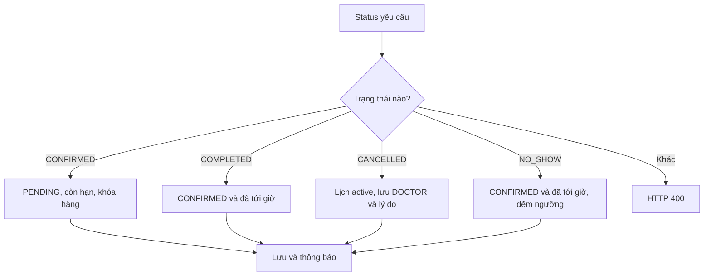

# API bác sĩ

<a id="getprofile"></a>

## GET `/api/v1/doctor/profile` — Xem hồ sơ chuyên môn của mình

### 1. Chức năng và vai trò

Xem hồ sơ chuyên môn của mình. **Vai trò sử dụng:** DOCTOR,PATIENT.

### 2. Đầu vào

| Trường | Kiểu | Vị trí | Điều kiện |
|---|---|---|---|
| `accessToken / Authorization` | `JWT` | Cookie / Bearer header | Phiên hợp lệ; đúng vai trò của API. |

### 3. Luồng xử lý kỹ thuật

Tra DoctorDetail theo user; nếu chưa có thì trả dữ liệu cơ bản để khai hồ sơ; kèm tình trạng transfer/credential gần nhất nếu đã có.

### 4. Đầu ra

200: DoctorProfileResponse.

### 5. Mã code

`WebDeveloper/Controllers/Api/DoctorApiController.cs:27`

```csharp
public async Task<IActionResult> GetProfile()
{
    // Lấy tài khoản hiện tại từ danh tính đã xác thực.
    var user = await SecurityHelper.GetCurrentUser(HttpContext, _db);
    // Gọi service thực hiện nghiệp vụ và kiểm tra điều kiện.
    return Ok(await _doctorService.GetProfile(user));
}

```

<a id="registerdoctor"></a>

## POST `/api/v1/doctor/profile` — Nộp hoặc nộp lại xác minh bác sĩ

### 1. Chức năng và vai trò

Nộp hoặc nộp lại xác minh bác sĩ. **Vai trò sử dụng:** DOCTOR,PATIENT.

### 2. Đầu vào

| Trường | Kiểu | Vị trí | Điều kiện |
|---|---|---|---|
| `accessToken / Authorization` | `JWT` | Cookie / Bearer header | Phiên hợp lệ; đúng vai trò của API. |
| `Bio` | `string` | Form multipart | Bắt buộc. |
| `Degree` | `string` | Form multipart | Học vị hợp lệ theo DoctorDegree. |
| `ExperienceYears` | `int` | Form multipart | Số năm ≥0. |
| `Price` | `double` | Form multipart | Giá hữu hạn, lớn hơn 0. |
| `IdCardImage` | `IFormFile?` | Form multipart | JPG/PNG; bắt buộc khi nộp lần đầu. |
| `CertificatePdf` | `IFormFile?` | Form multipart | PDF; bắt buộc khi nộp lần đầu. |
| `DiplomaPdf` | `IFormFile?` | Form multipart | Bằng cấp PDF; cần có tệp mới hoặc bằng cấp đã lưu. |
| `SpecialtyId` | `int` | Form multipart | ID tồn tại, đúng quyền và trạng thái theo service. |
| `FacilityId` | `int?` | Form multipart | Chọn cơ sở hiện có; hoặc dùng các trường cơ sở mới. |
| `NewFacilityName` | `string?` | Form multipart | Không có [Required]; điều kiện theo nhánh nghiệp vụ. |
| `FacilityAddress` | `string?` | Form multipart | Không có [Required]; điều kiện theo nhánh nghiệp vụ. |
| `FacilityDescription` | `string?` | Form multipart | Không có [Required]; điều kiện theo nhánh nghiệp vụ. |
| `FacilityMapUrl` | `string?` | Form multipart | Không có [Required]; điều kiện theo nhánh nghiệp vụ. |
| `NewFacilityProvince` | `string?` | Form multipart | Không có [Required]; điều kiện theo nhánh nghiệp vụ. |
| `FacilityLicensePdf` | `IFormFile?` | Form multipart | Giấy phép PDF khi tạo cơ sở mới. |

### 3. Luồng xử lý kỹ thuật

Kiểm học vị, giá, chuyên khoa active/cơ sở; cần bằng cấp PDF, lần đầu cần CCCD JPG/PNG và chứng chỉ PDF. Upload, tạo/sửa DoctorDetail PENDING; lần đầu đổi role database sang DOCTOR.

### 4. Đầu ra

200: chuỗi thông báo.

### 5. Mã code

`WebDeveloper/Controllers/Api/DoctorApiController.cs:35`

```csharp
public async Task<IActionResult> RegisterDoctor([FromForm] DoctorProfileRequest req)
{
    // Lấy tài khoản hiện tại từ danh tính đã xác thực.
    var user = await SecurityHelper.GetCurrentUser(HttpContext, _db);
    // Gọi service thực hiện nghiệp vụ và kiểm tra điều kiện.
    var msg = await _doctorService.RegisterDoctor(user, req);
    // Trả HTTP 200 với kết quả cho client.
    return Ok(msg);
}

```

<a id="changeprofile"></a>

## PUT `/api/v1/doctor/profile` — Sửa thông tin chuyên môn hiện tại

### 1. Chức năng và vai trò

Sửa thông tin chuyên môn hiện tại. **Vai trò sử dụng:** DOCTOR.

### 2. Đầu vào

| Trường | Kiểu | Vị trí | Điều kiện |
|---|---|---|---|
| `accessToken / Authorization` | `JWT` | Cookie / Bearer header | Phiên hợp lệ; đúng vai trò của API. |
| `bio` | `string?` | Body JSON | Không có [Required]; điều kiện theo nhánh nghiệp vụ. |
| `price` | `double?` | Body JSON | Giá hữu hạn, lớn hơn 0. |
| `facilityName` | `string?` | Body JSON | Không có [Required]; điều kiện theo nhánh nghiệp vụ. |
| `facilityAddress` | `string?` | Body JSON | Không có [Required]; điều kiện theo nhánh nghiệp vụ. |
| `facilityDescription` | `string?` | Body JSON | Không có [Required]; điều kiện theo nhánh nghiệp vụ. |
| `facilityMapUrl` | `string?` | Body JSON | Không có [Required]; điều kiện theo nhánh nghiệp vụ. |
| `facilityVerified` | `bool?` | Body JSON | Code hiện cho bác sĩ gửi trường này; cần giới hạn quyền phía API. |

### 3. Luồng xử lý kỹ thuật

Cập nhật Bio, giá hữu hạn >0 và các trường Facility được DTO cho phép; lưu và trả profile mới.

Code hiện còn cho sửa FacilityVerified và dữ liệu cơ sở chung.

### 4. Đầu ra

200: DoctorProfileResponse.

### 5. Mã code

`WebDeveloper/Controllers/Api/DoctorApiController.cs:44`

```csharp
public async Task<IActionResult> ChangeProfile([FromBody] ChangeProfileRequest req)
{
    // Lấy tài khoản hiện tại từ danh tính đã xác thực.
    var user = await SecurityHelper.GetCurrentUser(HttpContext, _db);
    // Gọi service thực hiện nghiệp vụ và kiểm tra điều kiện.
    return Ok(await _doctorService.ChangeProfile(user, req));
}

```

<a id="getschedules"></a>

## GET `/api/v1/doctor/schedules` — Ca làm việc còn thao tác

### 1. Chức năng và vai trò

Ca làm việc còn thao tác. **Vai trò sử dụng:** DOCTOR.

### 2. Đầu vào

| Trường | Kiểu | Vị trí | Điều kiện |
|---|---|---|---|
| `accessToken / Authorization` | `JWT` | Cookie / Bearer header | Phiên hợp lệ; đúng vai trò của API. |

### 3. Luồng xử lý kỹ thuật

Lấy ca của bác sĩ từ hôm nay, bỏ CLOSED/đã bắt đầu; khi đọc có thể tạo nhắc thiếu lịch trong 14 ngày tới theo điều kiện chống lặp.

### 4. Đầu ra

200: List<DoctorScheduleResponse>.

### 5. Mã code

`WebDeveloper/Controllers/Api/DoctorApiController.cs:52`

```csharp
public async Task<IActionResult> GetSchedules()
{
    // Lấy tài khoản hiện tại từ danh tính đã xác thực.
    var user = await SecurityHelper.GetCurrentUser(HttpContext, _db);
    // Gọi service thực hiện nghiệp vụ và kiểm tra điều kiện.
    return Ok(await _doctorService.GetSchedules(user));
}

```

<a id="createschedule"></a>

## POST `/api/v1/doctor/schedules` — Tạo/mở lại ca làm việc

### 1. Chức năng và vai trò

Tạo/mở lại ca làm việc. **Vai trò sử dụng:** DOCTOR.

### 2. Đầu vào

| Trường | Kiểu | Vị trí | Điều kiện |
|---|---|---|---|
| `accessToken / Authorization` | `JWT` | Cookie / Bearer header | Phiên hợp lệ; đúng vai trò của API. |
| `date` | `DateOnly?` | Body JSON | Ngày YYYY-MM-DD trong hôm nay..+30; dùng với SlotIds. |
| `endDate` | `DateOnly?` | Body JSON | Ngày cuối nếu tạo theo khoảng ngày. |
| `slotIds` | `List<string>?` | Body JSON | Danh sách enum ca như SLOT_09_00, SLOT_10_00. |
| `items` | `List<DayScheduleItem>?` | Body JSON | Danh sách {date, slotIds}; cách tạo ca theo từng ngày. |

### 3. Luồng xử lý kỹ thuật

APPROVED; chuẩn hóa Items hoặc Date–EndDate–SlotIds; hôm nay..+30; khóa transaction theo DoctorId; giữ AVAILABLE/BOOKED, mở CLOSED đủ điều kiện hoặc thêm ca mới.

### 4. Đầu ra

200: chuỗi thông báo số ca cập nhật theo service.

### 5. Mã code

`WebDeveloper/Controllers/Api/DoctorApiController.cs:60`

```csharp
public async Task<IActionResult> CreateSchedule([FromBody] ScheduleRequest req)
{
    // Lấy tài khoản hiện tại từ danh tính đã xác thực.
    var user = await SecurityHelper.GetCurrentUser(HttpContext, _db);
    // Gọi service thực hiện nghiệp vụ và kiểm tra điều kiện.
    return Ok(await _doctorService.CreateSchedule(user, req));
}

```

<a id="deleteschedule"></a>

## DELETE `/api/v1/doctor/schedules/{id}` — Đóng ca chưa sử dụng

### 1. Chức năng và vai trò

Đóng ca chưa sử dụng. **Vai trò sử dụng:** DOCTOR.

### 2. Đầu vào

| Trường | Kiểu | Vị trí | Điều kiện |
|---|---|---|---|
| `accessToken / Authorization` | `JWT` | Cookie / Bearer header | Phiên hợp lệ; đúng vai trò của API. |
| `id` | `int` | Path | Định danh đối tượng trong route. |

### 3. Luồng xử lý kỹ thuật

Kiểm chủ, chưa bắt đầu, không BOOKED và không có lịch chưa hủy; khóa theo bác sĩ, đổi CLOSED và tăng Version.

### 4. Đầu ra

200: chuỗi thông báo.

### 5. Mã code

`WebDeveloper/Controllers/Api/DoctorApiController.cs:68`

```csharp
public async Task<IActionResult> DeleteSchedule(int id)
{
    // Lấy tài khoản hiện tại từ danh tính đã xác thực.
    var user = await SecurityHelper.GetCurrentUser(HttpContext, _db);
    // Gọi service thực hiện nghiệp vụ và kiểm tra điều kiện.
    return Ok(await _doctorService.DeleteSchedule(user, id));
}

```

<a id="getappointments"></a>

## GET `/api/v1/doctor/appointment` — Lọc lịch hẹn của bác sĩ

### 1. Chức năng và vai trò

Lọc lịch hẹn của bác sĩ. **Vai trò sử dụng:** DOCTOR.

### 2. Đầu vào

| Trường | Kiểu | Vị trí | Điều kiện |
|---|---|---|---|
| `accessToken / Authorization` | `JWT` | Cookie / Bearer header | Phiên hợp lệ; đúng vai trò của API. |
| `status` | `BookingStatus?` | Query | Mặc định null. Trạng thái enum/chuỗi theo luồng xử lý. |
| `page` | `int` | Query | Mặc định 0. Trang bắt đầu từ 0. |
| `size` | `int` | Query | Mặc định 10. Số mục/trang; giới hạn theo từng endpoint. |

### 3. Luồng xử lý kỹ thuật

Lọc sở hữu và status nếu có. CONFIRMED lọc riêng sắp ngày tăng; mặc định ưu tiên nhóm CONFIRMED rồi PENDING; nạp kết quả để dựng DTO.

### 4. Đầu ra

200: PagedResult<DoctorAppointmentResponse>.

### 5. Mã code

`WebDeveloper/Controllers/Api/DoctorApiController.cs:76`

```csharp
public async Task<IActionResult> GetAppointments([FromQuery] BookingStatus? status = null, [FromQuery] int page = 0, [FromQuery] int size = 10)
{
    // Lấy tài khoản hiện tại từ danh tính đã xác thực.
    var user = await SecurityHelper.GetCurrentUser(HttpContext, _db);
    // Gọi service thực hiện nghiệp vụ và kiểm tra điều kiện.
    return Ok(await _doctorService.GetAppointments(user, status, page, size));
}

```

<a id="getoverdueappointments"></a>

## GET `/api/v1/doctor/appointments/overdue` — Lịch xác nhận đã qua ngày

### 1. Chức năng và vai trò

Lịch xác nhận đã qua ngày. **Vai trò sử dụng:** DOCTOR.

### 2. Đầu vào

| Trường | Kiểu | Vị trí | Điều kiện |
|---|---|---|---|
| `accessToken / Authorization` | `JWT` | Cookie / Bearer header | Phiên hợp lệ; đúng vai trò của API. |

### 3. Luồng xử lý kỹ thuật

Lọc lịch thuộc bác sĩ, CONFIRMED và DateWorking < hôm nay theo Việt Nam.

### 4. Đầu ra

200: List<DoctorAppointmentResponse>.

### 5. Mã code

`WebDeveloper/Controllers/Api/DoctorApiController.cs:84`

```csharp
public async Task<IActionResult> GetOverdueAppointments()
{
    // Lấy tài khoản hiện tại từ danh tính đã xác thực.
    var user = await SecurityHelper.GetCurrentUser(HttpContext, _db);
    // Gọi service thực hiện nghiệp vụ và kiểm tra điều kiện.
    return Ok(await _doctorService.GetOverdueConfirmedAppointments(user));
}

```

<a id="updatebookstatus"></a>

## PUT `/api/v1/doctor/appointment/{id}/status` — Xác nhận, hoàn thành, hủy hoặc báo vắng

### 1. Chức năng và vai trò

Xác nhận, hoàn thành, hủy hoặc báo vắng. **Vai trò sử dụng:** DOCTOR.

### 2. Đầu vào

| Trường | Kiểu | Vị trí | Điều kiện |
|---|---|---|---|
| `accessToken / Authorization` | `JWT` | Cookie / Bearer header | Phiên hợp lệ; đúng vai trò của API. |
| `id` | `int` | Path | Định danh đối tượng trong route. |
| `status` | `BookingStatus` | Query | Trạng thái enum/chuỗi theo luồng xử lý. |
| `reason` | `string?` | Query | Mặc định null. |

### 3. Luồng xử lý kỹ thuật

Action phân nhánh: CONFIRMED gọi ConfirmAppointment có FOR UPDATE và hạn 30 phút/trước giờ; COMPLETED gọi CompleteAppointment khi đã tới giờ; CANCELLED/NO_SHOW gọi DeclineAppointment, khóa chủ tài khoản, NO_SHOW đếm ngưỡng cảnh báo admin.



### 4. Đầu ra

200: chuỗi thông báo từ nhánh service; giá trị khác trả 400 chuỗi "Lỗi cập nhật trạng thái".

### 5. Mã code

`WebDeveloper/Controllers/Api/DoctorApiController.cs:92`

```csharp
public async Task<IActionResult> UpdateBookStatus(int id, [FromQuery] BookingStatus status, [FromQuery] string? reason = null)
{
    // Lấy tài khoản hiện tại từ danh tính đã xác thực.
    var user = await SecurityHelper.GetCurrentUser(HttpContext, _db);
    if (status == BookingStatus.CONFIRMED)
        // Gọi service thực hiện nghiệp vụ và kiểm tra điều kiện.
        return Ok(await _doctorService.ConfirmAppointment(user, id));
    else if (status == BookingStatus.COMPLETED)
        // Gọi service thực hiện nghiệp vụ và kiểm tra điều kiện.
        return Ok(await _doctorService.CompleteAppointment(user, id));

    if (status == BookingStatus.CANCELLED || status == BookingStatus.NO_SHOW)
        // Gọi service thực hiện nghiệp vụ và kiểm tra điều kiện.
        return Ok(await _doctorService.DeclineAppointment(user, id, status, reason));
    // Từ chối dữ liệu hoặc trạng thái không hợp lệ: HTTP 400.
    return BadRequest("Lỗi cập nhật trạng thái");
}

```

<a id="savemedicalresult"></a>

## POST `/api/v1/doctor/appointment/{id}/result` — Tạo hoặc lưu kết quả khám

### 1. Chức năng và vai trò

Tạo hoặc lưu kết quả khám. **Vai trò sử dụng:** DOCTOR.

### 2. Đầu vào

| Trường | Kiểu | Vị trí | Điều kiện |
|---|---|---|---|
| `accessToken / Authorization` | `JWT` | Cookie / Bearer header | Phiên hợp lệ; đúng vai trò của API. |
| `id` | `int` | Path | Định danh đối tượng trong route. |
| `FollowUpDate` | `DateOnly?` | Form multipart | Nếu có, phải sau ngày khám và sau hôm nay. |
| `Diagnosis` | `string?` | Form multipart | Service bắt buộc có chẩn đoán. |
| `DoctorNotes` | `string?` | Form multipart | Không có [Required]; điều kiện theo nhánh nghiệp vụ. |
| `PrescriptionLink` | `string?` | Form multipart | Link HTTP/HTTPS; không gửi cùng PrescriptionFile. |
| `PrescriptionFile` | `IFormFile?` | Form multipart | PDF/JPG/PNG/DOC/DOCX ≤5 MB; không gửi cùng link. |

### 3. Luồng xử lý kỹ thuật

Kiểm chủ ca, đã tới giờ, trạng thái CONFIRMED/COMPLETED và Diagnosis. FollowUpDate phải sau ngày khám và hôm nay; chỉ file hoặc link HTTP/HTTPS; lưu/tạo kết quả và COMPLETED cùng SaveChanges.

POST có thể sửa kết quả đã có; cùng hàm với PUT.

### 4. Đầu ra

200: chuỗi thông báo.

### 5. Mã code

`WebDeveloper/Controllers/Api/DoctorApiController.cs:107`

```csharp
public async Task<IActionResult> SaveMedicalResult(int id, [FromForm] MedicalResultRequest req)
{
    // Lấy tài khoản hiện tại từ danh tính đã xác thực.
    var user = await SecurityHelper.GetCurrentUser(HttpContext, _db);
    // Gọi service thực hiện nghiệp vụ và kiểm tra điều kiện.
    return Ok(await _doctorService.SaveMedicalResult(user, id, req));
}

```

<a id="updatemedicalresult"></a>

## PUT `/api/v1/doctor/appointment/{id}/result` — Cập nhật kết quả khám

### 1. Chức năng và vai trò

Cập nhật kết quả khám. **Vai trò sử dụng:** DOCTOR.

### 2. Đầu vào

| Trường | Kiểu | Vị trí | Điều kiện |
|---|---|---|---|
| `accessToken / Authorization` | `JWT` | Cookie / Bearer header | Phiên hợp lệ; đúng vai trò của API. |
| `id` | `int` | Path | Định danh đối tượng trong route. |
| `FollowUpDate` | `DateOnly?` | Form multipart | Nếu có, phải sau ngày khám và sau hôm nay. |
| `Diagnosis` | `string?` | Form multipart | Service bắt buộc có chẩn đoán. |
| `DoctorNotes` | `string?` | Form multipart | Không có [Required]; điều kiện theo nhánh nghiệp vụ. |
| `PrescriptionLink` | `string?` | Form multipart | Link HTTP/HTTPS; không gửi cùng PrescriptionFile. |
| `PrescriptionFile` | `IFormFile?` | Form multipart | PDF/JPG/PNG/DOC/DOCX ≤5 MB; không gửi cùng link. |

### 3. Luồng xử lý kỹ thuật

Cùng SaveMedicalResult với POST: kiểm quyền/trạng thái, lấy bản ghi theo AppointmentId rồi tạo/sửa và hoàn thành lịch.

PUT có thể tạo kết quả nếu chưa có; cùng hàm với POST.

### 4. Đầu ra

200: chuỗi thông báo.

### 5. Mã code

`WebDeveloper/Controllers/Api/DoctorApiController.cs:115`

```csharp
public async Task<IActionResult> UpdateMedicalResult(int id, [FromForm] MedicalResultRequest req)
{
    // Lấy tài khoản hiện tại từ danh tính đã xác thực.
    var user = await SecurityHelper.GetCurrentUser(HttpContext, _db);
    // Gọi service thực hiện nghiệp vụ và kiểm tra điều kiện.
    return Ok(await _doctorService.SaveMedicalResult(user, id, req));
}

```

<a id="getreviews"></a>

## GET `/api/v1/doctor/reviews` — Đánh giá liên quan bác sĩ

### 1. Chức năng và vai trò

Đánh giá liên quan bác sĩ. **Vai trò sử dụng:** DOCTOR.

### 2. Đầu vào

| Trường | Kiểu | Vị trí | Điều kiện |
|---|---|---|---|
| `accessToken / Authorization` | `JWT` | Cookie / Bearer header | Phiên hợp lệ; đúng vai trò của API. |
| `page` | `int` | Query | Mặc định 0. Trang bắt đầu từ 0. |
| `size` | `int` | Query | Mặc định 10. Số mục/trang; giới hạn theo từng endpoint. |

### 3. Luồng xử lý kỹ thuật

Lọc review theo bác sĩ hiện tại, phân trang và trả nội dung/sao/trạng thái hiển thị.

### 4. Đầu ra

200: PagedResult<DoctorReviewResponse>.

### 5. Mã code

`WebDeveloper/Controllers/Api/DoctorApiController.cs:123`

```csharp
public async Task<IActionResult> GetReviews([FromQuery] int page = 0, [FromQuery] int size = 10)
{
    // Lấy tài khoản hiện tại từ danh tính đã xác thực.
    var user = await SecurityHelper.GetCurrentUser(HttpContext, _db);
    // Gọi service thực hiện nghiệp vụ và kiểm tra điều kiện.
    return Ok(await _doctorService.GetReviews(user, page, size));
}

```

<a id="requestcredentialchange"></a>

## POST `/api/v1/doctor/credentials` — Đề nghị đổi học vị/giấy tờ

### 1. Chức năng và vai trò

Đề nghị đổi học vị/giấy tờ. **Vai trò sử dụng:** DOCTOR.

### 2. Đầu vào

| Trường | Kiểu | Vị trí | Điều kiện |
|---|---|---|---|
| `accessToken / Authorization` | `JWT` | Cookie / Bearer header | Phiên hợp lệ; đúng vai trò của API. |
| `Kind` | `string` | Form multipart | DEGREE, DIPLOMA hoặc CERTIFICATE. |
| `Degree` | `string?` | Form multipart | Học vị mới nếu Kind=DEGREE; theo DoctorDegree. |
| `Document` | `IFormFile?` | Form multipart | Bắt buộc; minh chứng PDF ≤5 MB. |

### 3. Luồng xử lý kỹ thuật

Yêu cầu hồ sơ APPROVED, Kind DEGREE/DIPLOMA/CERTIFICATE và minh chứng PDF; lưu giá trị cũ/mới PENDING. Unique partial index chỉ cho một PENDING mỗi bác sĩ; thông báo cho bác sĩ/admin.

### 4. Đầu ra

200: chuỗi thông báo.

### 5. Mã code

`WebDeveloper/Controllers/Api/DoctorApiController.cs:131`

```csharp
public async Task<IActionResult> RequestCredentialChange([FromForm] CredentialChangeRequest req)
{
    // Lấy tài khoản hiện tại từ danh tính đã xác thực.
    var user = await SecurityHelper.GetCurrentUser(HttpContext, _db);
    // Gọi service thực hiện nghiệp vụ và kiểm tra điều kiện.
    return Ok(await _doctorService.CreateCredentialRequest(user, req));
}

```

<a id="requesttransfer"></a>

## POST `/api/v1/doctor/transfer` — Đề nghị chuyển cơ sở

### 1. Chức năng và vai trò

Đề nghị chuyển cơ sở. **Vai trò sử dụng:** DOCTOR.

### 2. Đầu vào

| Trường | Kiểu | Vị trí | Điều kiện |
|---|---|---|---|
| `accessToken / Authorization` | `JWT` | Cookie / Bearer header | Phiên hợp lệ; đúng vai trò của API. |
| `targetFacilityId` | `int` | Body JSON | ID tồn tại, đúng quyền và trạng thái theo service. |
| `reason` | `string?` | Body JSON | Không có [Required]; điều kiện theo nhánh nghiệp vụ. |

### 3. Luồng xử lý kỹ thuật

Kiểm cơ sở khác hiện tại/chưa có PENDING; ghi yêu cầu và snapshot OldFacilityName, tạo notification theo collector.

### 4. Đầu ra

200: chuỗi thông báo.

### 5. Mã code

`WebDeveloper/Controllers/Api/DoctorApiController.cs:139`

```csharp
public async Task<IActionResult> RequestTransfer([FromBody] TransferRequestDto req)
{
    // Lấy tài khoản hiện tại từ danh tính đã xác thực.
    var user = await SecurityHelper.GetCurrentUser(HttpContext, _db);
    // Gọi service thực hiện nghiệp vụ và kiểm tra điều kiện.
    return Ok(await _doctorService.CreateTransferRequest(user, req));
}

```
