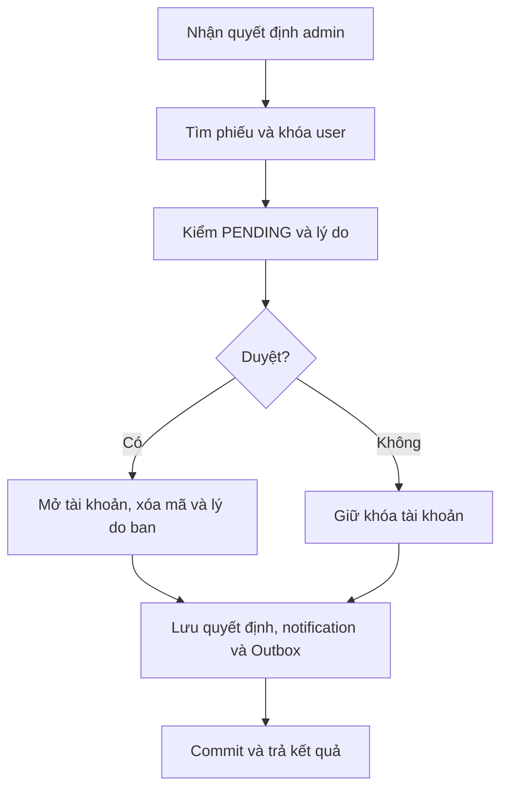

# Kháng nghị mở khóa

<a id="status"></a>

## POST `/api/v1/auth/appeals/status` — Tra cứu kết quả kháng nghị

### 1. Chức năng và vai trò

Tra cứu kết quả kháng nghị. **Vai trò sử dụng:** Công khai.

### 2. Đầu vào

| Trường | Kiểu | Vị trí | Điều kiện |
|---|---|---|---|
| `email` | `string` | Body JSON | Email hợp lệ. |
| `password` | `string` | Body JSON | Bắt buộc. |

### 3. Luồng xử lý kỹ thuật

Xác minh email/password bằng BCrypt nhưng không tạo phiên; lấy phiếu mới nhất theo Id của user.

Rate limit: 10 request/phút/IP; resend còn giới hạn một mã mới/phút/tài khoản.

### 4. Đầu ra

200: {isActive, reasonBanned, appeal}; appeal có thể null; sai credentials trả 401.

### 5. Mã code

`WebDeveloper/Controllers/Api/AccountAppealsController.cs:31`

```csharp
public async Task<IActionResult> Status(Credentials req)
{
    // Kiểm email/mật khẩu nhưng không cấp phiên đăng nhập.
    var user = await Verify(req.Email, req.Password);
    // Credential không hợp lệ: HTTP 401.
    if (user == null) return Unauthorized(new { message = "Email hoặc mật khẩu không chính xác." });
    var appeal = await db.AccountAppeals.AsNoTracking().Where(a => a.UserId == user.UserId)
        .OrderByDescending(a => a.Id).Select(a => new { a.Status, a.AdminReason, a.CreatedAt, a.ProcessedAt }).FirstOrDefaultAsync();
    // Trả HTTP 200 với kết quả cho client.
    return Ok(new { isActive = user.IsActive, reasonBanned = user.ReasonBanned, appeal });
}

```

<a id="submit"></a>

## POST `/api/v1/auth/appeals` — Gửi/cập nhật phiếu xin mở khóa

### 1. Chức năng và vai trò

Gửi/cập nhật phiếu xin mở khóa. **Vai trò sử dụng:** Công khai.

### 2. Đầu vào

| Trường | Kiểu | Vị trí | Điều kiện |
|---|---|---|---|
| `email` | `string` | Body JSON | Email hợp lệ. |
| `password` | `string` | Body JSON | Bắt buộc. |
| `reason` | `string` | Body JSON | Bắt buộc; 10–1000 ký tự. |

### 3. Luồng xử lý kỹ thuật

Xác minh credentials; chỉ user bị khóa hợp lệ, không ADMIN/active/chưa xác minh. Khóa theo user, đọc lại active, sửa phiếu PENDING hoặc thêm; báo admin active, commit.

Rate limit: 10 request/phút/IP; resend còn giới hạn một mã mới/phút/tài khoản.

### 4. Đầu ra

200: {message}; sai credentials 401; không thuộc diện 400; mở khóa trong lúc chờ 409.

### 5. Mã code

`WebDeveloper/Controllers/Api/AccountAppealsController.cs:41`

```csharp
public async Task<IActionResult> Submit(SubmitRequest req)
{
    // Kiểm email/mật khẩu nhưng không cấp phiên đăng nhập.
    var user = await Verify(req.Email, req.Password);
    // Credential không hợp lệ: HTTP 401.
    if (user == null) return Unauthorized(new { message = "Email hoặc mật khẩu không chính xác." });
    if (user.IsActive == true || AccountState.AwaitingEmailVerification(user) || user.Role == RoleStatus.ADMIN)
        // Từ chối dữ liệu hoặc trạng thái không hợp lệ: HTTP 400.
        return BadRequest(new { message = "Tài khoản này không thuộc diện yêu cầu mở khóa." });
    // Từ chối dữ liệu hoặc trạng thái không hợp lệ: HTTP 400.
    if (req.Reason.Trim().Length < 10) return BadRequest(new { message = "Vui lòng trình bày lý do ít nhất 10 ký tự." });
    // Bắt đầu giao dịch để nhóm các thay đổi database.
    await using var tx = await db.Database.BeginTransactionAsync();
    // Khóa theo tài khoản tới khi giao dịch kết thúc.
    await db.Database.ExecuteSqlInterpolatedAsync($"SELECT pg_advisory_xact_lock({-user.UserId})");
    // Đọc lại trạng thái sau khi lấy khóa.
    await db.Entry(user).ReloadAsync();
    // Trạng thái đã thay đổi: HTTP 409.
    if (user.IsActive == true) return Conflict(new { message = "Tài khoản đã được mở khóa." });
    var existingPending = await db.AccountAppeals.FirstOrDefaultAsync(a => a.UserId == user.UserId && a.Status == "PENDING");
    if (existingPending != null)
    {
        existingPending.Reason = req.Reason.Trim();
        existingPending.CreatedAt = DateTime.UtcNow;
    }
    else
    {
        db.AccountAppeals.Add(new AccountAppeal { UserId = user.UserId, Reason = req.Reason.Trim(), CreatedAt = DateTime.UtcNow });
    }
    var senderName = string.IsNullOrWhiteSpace(user.FullName) ? user.Email : user.FullName;
    foreach (var adminId in await db.Users.Where(u => u.Role == RoleStatus.ADMIN && u.IsActive == true).Select(u => u.UserId).ToListAsync())
        db.Notifications.Add(new Notification { UserId = adminId, Title = "Yêu cầu mở khóa tài khoản", Message = $"{senderName} đã gửi phiếu xin mở khóa.", Url = "/Admin/Appeals" });
    // Lưu các thay đổi đang được theo dõi.
    await db.SaveChangesAsync();
    // Chấp nhận giao dịch.
    await tx.CommitAsync();
    // Trả HTTP 200 với kết quả cho client.
    return Ok(new { message = existingPending != null 
        ? "Đã cập nhật lại nội dung phiếu xin mở khóa của bạn thành công." 
        : "Đã gửi phiếu xin mở khóa thành công. Bạn có thể kiểm tra kết quả tại đây." });
}

```

<a id="counts"></a>

## GET `/api/v1/admin/appeals/count` — Đếm phiếu theo trạng thái

### 1. Chức năng và vai trò

Đếm phiếu theo trạng thái. **Vai trò sử dụng:** ADMIN.

### 2. Đầu vào

| Trường | Kiểu | Vị trí | Điều kiện |
|---|---|---|---|
| `accessToken / Authorization` | `JWT` | Cookie / Bearer header | Phiên hợp lệ; đúng vai trò của API. |

### 3. Luồng xử lý kỹ thuật

Đếm riêng PENDING, APPROVED, REJECTED bằng EF Core.

### 4. Đầu ra

200: {pending, approved, rejected}.

### 5. Mã code

`WebDeveloper/Controllers/Api/AccountAppealsController.cs:73`

```csharp
public async Task<IActionResult> Counts()
{
    var pending = await db.AccountAppeals.CountAsync(a => a.Status == "PENDING");
    var approved = await db.AccountAppeals.CountAsync(a => a.Status == "APPROVED");
    var rejected = await db.AccountAppeals.CountAsync(a => a.Status == "REJECTED");
    // Trả HTTP 200 với kết quả cho client.
    return Ok(new { pending, approved, rejected });
}

```

<a id="list"></a>

## GET `/api/v1/admin/appeals` — Danh sách phiếu kháng nghị

### 1. Chức năng và vai trò

Danh sách phiếu kháng nghị. **Vai trò sử dụng:** ADMIN.

### 2. Đầu vào

| Trường | Kiểu | Vị trí | Điều kiện |
|---|---|---|---|
| `accessToken / Authorization` | `JWT` | Cookie / Bearer header | Phiên hợp lệ; đúng vai trò của API. |
| `status` | `string` | Query | Mặc định "PENDING". Trạng thái enum/chuỗi theo luồng xử lý. |
| `page` | `int` | Query | Mặc định 0. Trang bắt đầu từ 0. |

### 3. Luồng xử lý kỹ thuật

Lọc Status chính xác, sắp Id giảm, page âm thành 0, mỗi trang cố định 20; chiếu thông tin user/phiếu.

### 4. Đầu ra

200: array object, không có PagedResult/total/hasMore.

### 5. Mã code

`WebDeveloper/Controllers/Api/AccountAppealsController.cs:82`

```csharp
public async Task<IActionResult> List(string status = "PENDING", int page = 0)
// Trả HTTP 200 với kết quả cho client.
=> Ok(await db.AccountAppeals.AsNoTracking().Where(a => a.Status == status)
    .OrderByDescending(a => a.Id).Skip(Math.Max(0, page) * 20).Take(20)
    .Select(a => new { a.Id, a.UserId, a.User.FullName, a.User.Email, a.User.ReasonBanned, a.Reason, a.Status, a.AdminReason, a.CreatedAt, a.ProcessedAt }).ToListAsync());

```

<a id="process"></a>

## PUT `/api/v1/admin/appeals/{id:int}` — Quyết định phiếu xin mở khóa

### 1. Chức năng và vai trò

Quyết định phiếu xin mở khóa. **Vai trò sử dụng:** ADMIN.

### 2. Đầu vào

| Trường | Kiểu | Vị trí | Điều kiện |
|---|---|---|---|
| `accessToken / Authorization` | `JWT` | Cookie / Bearer header | Phiên hợp lệ; đúng vai trò của API. |
| `id` | `int` | Path | Định danh đối tượng trong route. |
| `approve` | `bool` | Body JSON | true: duyệt; false: từ chối. Bỏ trường thì bool mặc định false. |
| `reason` | `string?` | Body JSON | Từ chối cần 3–1000 ký tự; duyệt không bắt buộc. |

### 3. Luồng xử lý kỹ thuật

Tìm phiếu rồi khóa user; chỉ PENDING; từ chối cần Reason 3–1000. Ghi trạng thái/admin/thời điểm; duyệt bật active, xóa mã/ban. Notification và Outbox quyết định cùng transaction.



### 4. Đầu ra

200: {message}; phiếu không có 404; đã xử lý hoặc user cần xác minh 409; thiếu lý do từ chối 400.

### 5. Mã code

`WebDeveloper/Controllers/Api/AccountAppealsController.cs:88`

```csharp
public async Task<IActionResult> Process(int id, Decision req)
{
    // Từ chối dữ liệu hoặc trạng thái không hợp lệ: HTTP 400.
    if (!req.Approve && (req.Reason?.Trim().Length ?? 0) < 3) return BadRequest(new { message = "Vui lòng nhập lý do từ chối (3–1000 ký tự)." });
    var decisionReason = req.Approve ? "Yêu cầu mở khóa đã được duyệt." : req.Reason!.Trim();
    // Bắt đầu giao dịch để nhóm các thay đổi database.
    await using var tx = await db.Database.BeginTransactionAsync();
    var userId = await db.AccountAppeals.Where(a => a.Id == id).Select(a => (int?)a.UserId).SingleOrDefaultAsync();
    // Không có bản ghi phù hợp: HTTP 404.
    if (userId == null) return NotFound();
    // Khóa theo tài khoản tới khi giao dịch kết thúc.
    await db.Database.ExecuteSqlInterpolatedAsync($"SELECT pg_advisory_xact_lock({-userId.Value})");
    var appeal = await db.AccountAppeals.Include(a => a.User).SingleAsync(a => a.Id == id);
    // Trạng thái đã thay đổi: HTTP 409.
    if (appeal.Status != "PENDING") return Conflict(new { message = "Phiếu đã được xử lý." });
    appeal.Status = req.Approve ? "APPROVED" : "REJECTED";
    appeal.AdminReason = decisionReason;
    appeal.ProcessedAt = DateTime.UtcNow;
    appeal.ProcessedBy = int.Parse(User.FindFirstValue(ClaimTypes.NameIdentifier)!);
    if (req.Approve)
    {
        if (AccountState.AwaitingEmailVerification(appeal.User))
            // Trạng thái đã thay đổi: HTTP 409.
            return Conflict(new { message = "Tài khoản cần xác thực email trước." });
        AccountState.ClearOneTimeCode(appeal.User);
        appeal.User.IsActive = true;
        appeal.User.ReasonBanned = null;
    }
    db.Notifications.Add(new Notification { UserId = appeal.UserId, Title = req.Approve ? "Tài khoản đã được mở khóa" : "Yêu cầu mở khóa bị từ chối", Message = decisionReason, Url = "/" });
    // Lưu bền ý định gửi email trong cùng giao dịch.
    db.EmailOutbox.Add(new EmailOutbox { UserId = appeal.UserId, Kind = "AccountDecision", DeliveryKey = $"appeal:{appeal.Id}", Approved = req.Approve, Reason = decisionReason });
    // Lưu các thay đổi đang được theo dõi.
    await db.SaveChangesAsync();
    // Chấp nhận giao dịch.
    await tx.CommitAsync();
    // Trả HTTP 200 với kết quả cho client.
    return Ok(new { message = "Đã xử lý phiếu; email kết quả đang được gửi." });
}

```
