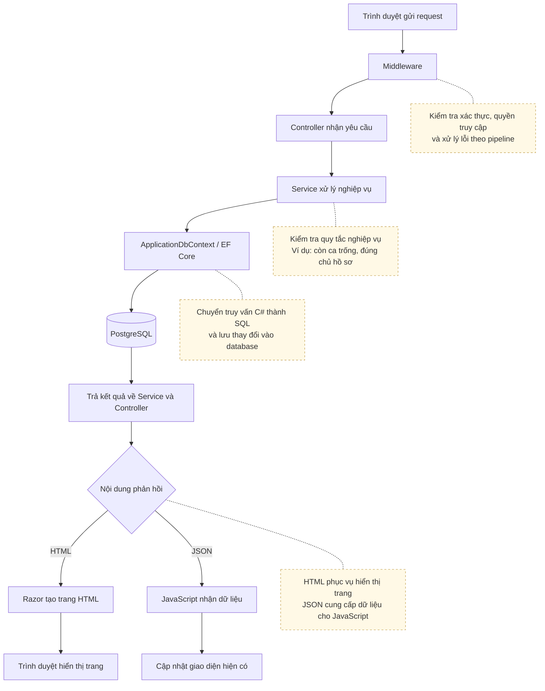
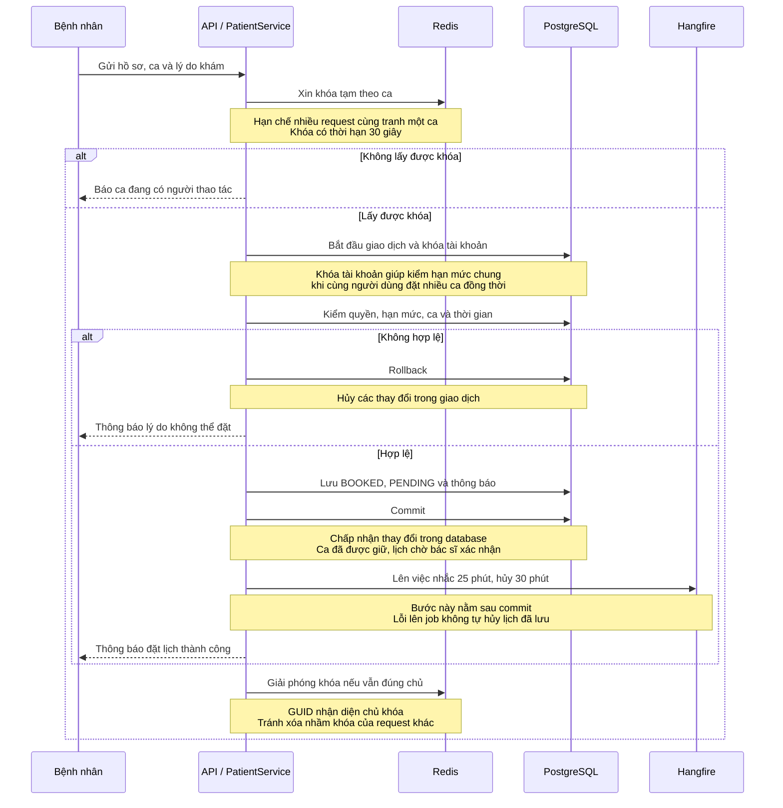
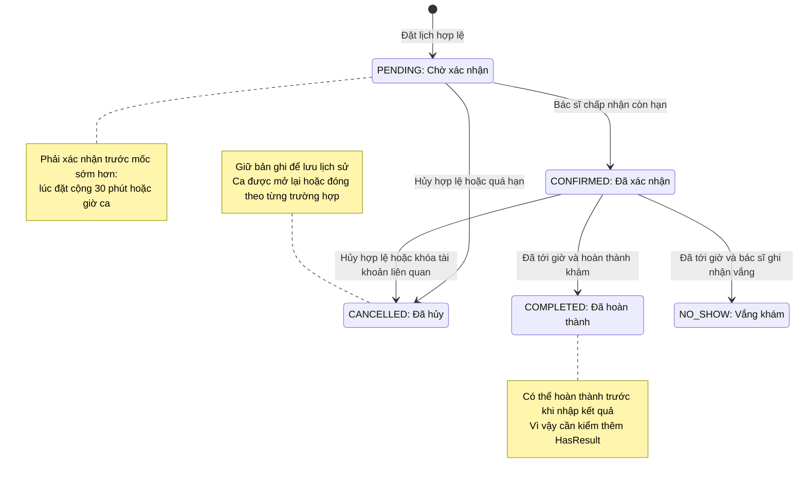
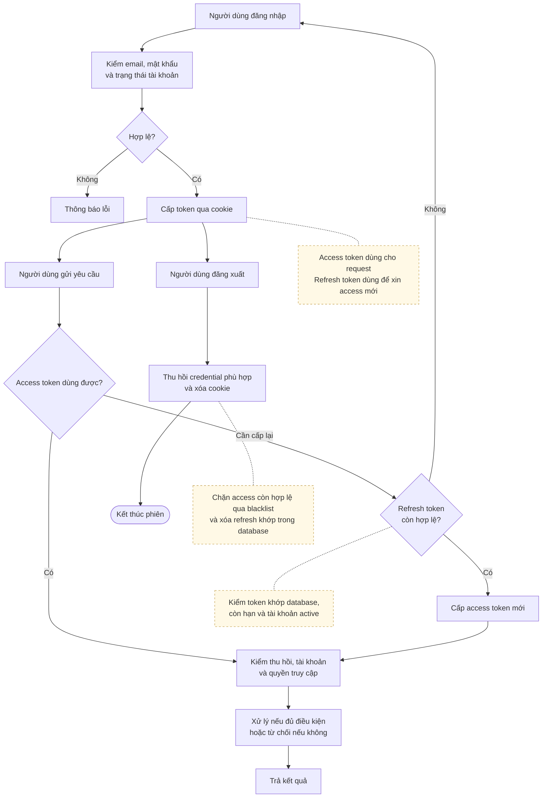

# API WebDeveloper
| Nhóm API | Số endpoint |
|---|---|
| [Xác thực và quản lý phiên](01-auth.md) | 7 |
| [Tra cứu công khai](02-public.md) | 8 |
| [Tài khoản hiện tại](03-user.md) | 4 |
| [API bệnh nhân](04-patient.md) | 13 |
| [API bác sĩ](05-doctor.md) | 14 |
| [API quản trị](06-admin.md) | 26 |
| [Danh mục quản trị](07-admin-catalog.md) | 3 |
| [Kháng nghị mở khóa](08-account-appeals.md) | 5 |
| [Thông báo](09-notifications.md) | 5 |
| [Gửi lại xác minh email](10-verification-email.md) | 1 |

# Một số luồng quan trọng
## Một HTTP request cần database

Đây là luồng phổ biến, không bắt buộc mọi request qua service/database. Controller appeal, notification và catalog có query trực tiếp.

## Đặt lịch và commit

TTL Redis không thay thế database. Hai ca khác nhau vẫn cần khóa theo tài khoản để bảo vệ quota chung. Cleanup finally cũng có thể lỗi sau commit.

## Trạng thái lịch hẹn

Hạn xác nhận là mốc sớm hơn giữa đặt+30 phút và giờ ca. Complete chưa chứng minh đã có kết quả. SlotStatus là máy trạng thái khác với BookingStatus.

## Đăng nhập và Đăng xuất

